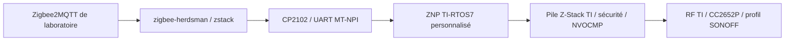

# Phases C et D — architecture retenue

Deux cibles sont distinctes. Le diagnostic UART et le coordinateur ZNP complet sont maintenant compilés localement. Le coordinateur utilise la pile TI et le profil SONOFF Koenkk ; ni l'un ni l'autre n'a été exécuté sur un dongle. La [voie autonome de build](build.md) utilise TI Clang et SysConfig sans CCS.

La variante optimisée ajoute le parseur/pool TX NPI, le cache et l'index NV, TLSF, 24 timers statiques, le watchdog à quorum, le garde radio, les files de messages constantes et la capture d'autodétection UART. Treize variantes TI sont générées, dont le script de liaison, sans modifier leurs originaux. Le parseur et la négociation de débit restent dans la tâche NPI ; pool TX, tas et files utilisent les sections critiques TI, NV le mutex NVOCMP. Les destructions de timers depuis un callback sont différées. Le garde radio précède le traitement NWK. Voir [optimizations.md](optimizations.md), [nv-directory.md](nv-directory.md), [queues.md](queues.md) et [uart-autobaud.md](uart-autobaud.md).

Le projet TI `znp_CC1352P_2_LAUNCHXL_tirtos7_ticlang`, SDK 8.30.01.01, est la base retenue pour le coordinateur. Le patch Koenkk contient déjà des adaptations de tables, du routage source, des fonctions MT étendues, la récupération NVOCMP et un traitement de fin TX UART2. Ces modifications sont **celles de Koenkk** ; elles ne sont pas présentées comme de nouvelles optimisations créées ici.

## Diagnostic réalisé

Un pool TX de huit trames alimente deux files FIFO. Deux emplacements sont réservés au contrôle ; les réponses/confirmations ont priorité, avec un quota de quatre trames avant de servir un événement normal en attente. Une trame en cours reste indivisible. Les rejets sont comptés par classe. Aucun tas ni allocation dynamique. La boucle UART lit et écrit au plus 32 octets par passage, avec les fonctions TI non bloquantes, et traite les flags d'erreur RX. Le pool et le parseur sont utilisés uniquement par la boucle principale ; **ils ne sont pas sûrs pour un partage ISR/tâche**. SysTick ne touche qu'au compteur de temps.

Le module `diagnostic.c` répond à SYS_PING (capacité SYS seulement), SYS_VERSION (produit expérimental 0xfe, version 0.1.0, révision 0) et SYS_GET_EXTADDR. Sur MCU, l'adresse provient de FCFG1 ; sur PC, les tests injectent une valeur synthétique. Les commandes non prises en charge renvoient l'erreur MT RPC correspondante. Les AREQ sont ignorées : pas de reset logiciel, de commandes NV ni de commandes RF.

Le démarrage et les vecteurs viennent de `startup_gcc.c` TI avec `SetupTrimDevice`. Le code de carte sélectionne HF XOSC et UART TX13/RX12, 115200 8N1, sans CTS/RTS. Le LF du diagnostic est RC, sans mise en veille. Le radio core n'est pas démarré et aucun réseau n'est formé. CCFG permet bootloader DIO15 bas, effacement et debug ; les secteurs NV sont absents de l'HEX, ce qui **ne garantit pas leur conservation par un flasher**.

Limites connues : pas de récupération watchdog, attentes de stabilisation horloge/alimentation sans timeout, pas d'instrumentation CPU exposée en MT, traitement des flags UART non validé sur matériel. Un XOR n'est pas un mécanisme cryptographique ; les tests de bruit ne prouvent pas une fiabilité RF. Il s'agit d'une cible de bring-up de laboratoire, sans promesse d'usage prolongé.

## Pourquoi pas une nouvelle pile Rust/FreeRTOS maintenant ?

[cortex-m](https://github.com/rust-embedded/cortex-m) fournit démarrage et registres CPU ; les [PAC cc13x2_26x2](https://docs.rs/crate/cc13x2_26x2_pac/0.10.3) décrivent les périphériques. Ce ne sont pas des HAL radio Zigbee complètes. Une liaison Rust/C aux drivers TI est envisageable après validation de l'ABI, des interruptions, de l'ordonnancement RF et de la pile utilisée. Le remplacement de TI-RTOS7 par FreeRTOS n'est pas une option que l'on peut activer en conservant implicitement toutes les bibliothèques Z-Stack.

OpenThread et Contiki-NG fournissent des exemples de port radio et de systèmes embarqués, mais Thread/6LoWPAN ne sont pas Zigbee NWK/APS/ZDO. [TI ot-ti](https://github.com/TexasInstruments/ot-ti) ne remplace donc pas un ZNP. [zigbee-on-host](https://github.com/Nerivec/zigbee-on-host) est une alternative indépendante pertinente pour un chantier RCP/Spinel ; elle change le pilote hôte et n'atteint pas l'exigence actuelle `adapter: zstack` à elle seule.

## Jalons et critères vérifiables

| Jalon | Critère d'acceptation | État |
|---|---|---|
| D0, logiciel PC | Vecteurs MT, fragments/bruit, file et erreurs, tests CCFG | Réalisé localement |
| D1, image ARM | ELF lié, HEX exporté, vecteurs et CCFG contrôlés | Réalisé ; fonctionnement MCU non testé |
| D2, transport physique | Réponses UART correctes, débit/erreurs sur CP2102 de laboratoire | Non exécuté |
| D3, vrai ZNP | Build TI complet, SYS/UTIL/NV/APP_CNF, démarrage herdsman jusqu'à état coordinateur | Build complet réalisé et image contrôlée ; démarrage herdsman sur dongle non exécuté |
| D4, réseau | Nouveau réseau test, un routeur et un terminal associés, échange APS/ZDO/ZCL bidirectionnel | Non exécuté |
| D5, persistance | Coupures, clés/compteurs, sauvegarde-restauration sans réassociation et sans répétition des compteurs | Non exécuté |
| D6, robustesse | Routage multi-sauts, capteurs endormis, tempêtes et endurance | Non exécuté |

Le code de `ZStackAdapter.start()` puis de `ZnpAdapterManager.start()` dans le snapshot herdsman montre qu'après ping/version viennent initialisation NV, vérification réseau, configuration, endpoints et commissioning. Le diagnostic ne fournit pas ces opérations. Il ne faut ni annoncer le produit ZStack3x0, ni simuler des succès NV pour faire croire à un démarrage réussi.

**Phase C terminée ; D0/D1 et construction du vrai ZNP réalisées.** Le SDK et les outils TI autonomes sont installés dans le projet. Restent les validations physiques D2 à D6 sur matériel de laboratoire ; aucune étape n'a été exercée sur la production.
