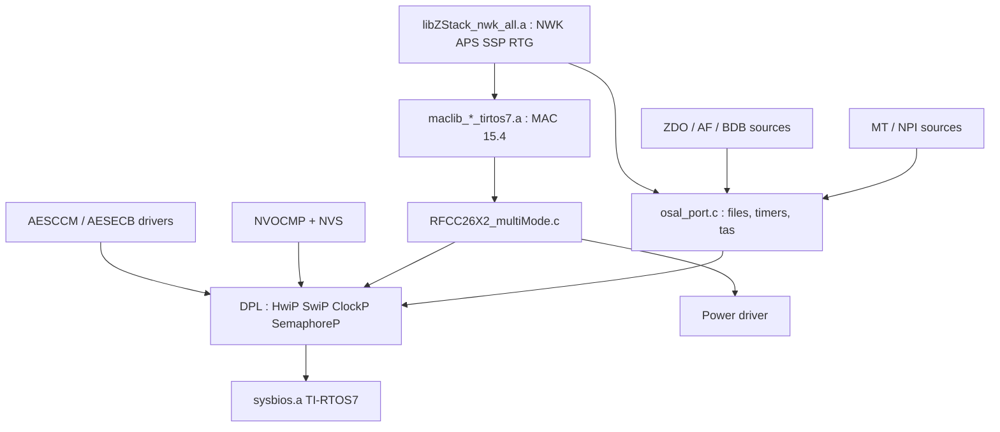

# Phase A — audit de faisabilité FreeRTOS

18 novembre 2026, branche `freeRTOS`. Audit du dépôt au commit `7b1bf7a`, du SDK TI **8.33.00.16** installé dans `vendor-sdk/` et du noyau **FreeRTOS-Kernel V11.1.0** (`dbf7055`, MIT) épinglé dans `sources.lock.json`. Aucune action matérielle n'a été effectuée pour cet audit.

## 1. Ce qui est réellement lié dans le coordinateur actuel (2026111802)

Liste générée par SysConfig pour `znp_CC1352P_2_LAUNCHXL_tirtos7_ticlang` (`ti_utils_build_linker.cmd.genlibs`) :

| Bibliothèque liée | Rôle | Sources disponibles ? | Lien à TI-RTOS7 |
|---|---|---|---|
| `sysbios.a` | Noyau TI-RTOS7 | Oui (`kernel/tirtos7`) | C'est TI-RTOS7 |
| `drivers_cc13x2.a` | UART2, NVS, crypto, Power, GPIO… | Oui (`source/ti/drivers`) | Via DPL (existe en DPL FreeRTOS) |
| `rf_multiMode_cc13x2.a` | Driver RF (ordonnanceur RF) | **Oui** : `RFCC26X2_multiMode.c`, BSD | Via DPL + Power driver |
| `driverlib.lib` | Accès registres | Oui, BSD | Aucun |
| `maclib_nosecure_cc13x2_2_4g_tirtos7.a` | **MAC IEEE 802.15.4 TI-15.4** | **Non** (seuls `mac_settings.c`, `mac_cfg.c`, ROM init) | Variante `tirtos7` ; une variante `freertos` existe aussi |
| `libZStack_nwk_all.a` (via alias du projet) | **NWK, APS, SSP, routage, adressage, associations** | **Non** (en-têtes + `nwk_globals.c`, `nwk_util.c`, `binding_table.c`) | Via OSAL/ICall |
| `display`, `grlib`, `spiffs` | Inutiles au coordinateur | Oui | — |

En source dans le projet ZNP : ZDO (`zd_*.c`), AF, BDB, ZCL, GP, MT, NPI, NVOCMP, `zd_sec_mgr.c`, le port OSAL (`osal_port.c`) et les adaptations Koenkk/de ce dépôt (`build/coordinator-overlay-sdk833-r2/`).

## 2. Cartographie des dépendances TI-RTOS7

Points d'ancrage TI-RTOS7 relevés dans les sources du coordinateur : `Task_construct`/`Semaphore`/`GateMutexPri` (stubs de test `tests/ti_stubs/ti/sysbios/...`), `ClockP` (timers OSAL `port_timers.c`), `HwiP_disable` (sections critiques du pool TX, du tas, des files), `osalHeapInitFxn` appelé par `Startup_exec` puis `BIOS_init` (cause du défaut 2026111801), `Watchdog` TI. Les optimisations existantes ont été écrites **contre ces interfaces** dans `firmware/platform/ti_znp/`.

## 3. Inventaire et classement des composants

| Composant | Fichiers | Dépendance | Décision |
|---|---|---|---|
| Parseur MT, pool TX | `firmware/src/npi.c` | Aucune | **Conservé tel quel** (lié à la cible FreeRTOS) |
| Index Patricia | `core_index.c` | Aucune | **Conservé tel quel** |
| Sécurité NWK ENC-MIC-32 + anti-rejeu | `core_security.c` | Backend CCM injecté | **Conservé**, backend CCM* logiciel fourni ; backend matériel à écrire |
| Messages indirects, broadcasts | `core_indirect.c`, `core_broadcast.c` | Aucune dans le cœur | **Conservés**, à raccorder à la future NWK native |
| TLSF / `port_heap.c` | `port_heap.c` + clone TLSF | Aucune | **Conservé** pour un tas borné de pile ; non nécessaire au noyau (allocation statique) |
| Cache/index NV | `nv_cache.c`, `nv_index.c` | Format NVOCMP | **Adapté** : réutilisable comme cache d'un futur stockage natif ; le format NVOCMP lui-même reste lié à TI |
| Garde radio NWK | `radio_guard.c` | Aucune | **Conservé**, à placer avant la NWK native |
| Autobaud | `autobaud.c` | Aucune | Conservé, toujours désactivé |
| Adaptateurs TI | `firmware/platform/ti_znp/*` | OSAL, TI-RTOS, objets NWK | **Non migrables** : ils n'ont de sens qu'avec Z-Stack |
| Démarrage, CCFG, UART | `firmware/platform/sonoff_cc2652p/*` | driverlib | **Réécrits** pour FreeRTOS (`firmware/freertos/startup`, `board`, `hal`) |
| Noyau TI-RTOS7 | `sysbios.a` | — | **Remplacé** par FreeRTOS V11.1.0 |
| Drivers TI (UART2, NVS…) | `drivers_cc13x2.a` | DPL | **Remplacés** par une HAL directe sur driverlib (UART, WDT) ; les DPL FreeRTOS de TI restent une option documentée |
| Driver RF TI | `RFCC26X2_multiMode.c` | DPL + Power | **Réécrit** : driver doorbell direct (`drivers/radio/rf_ieee.c`), sans DPL ni Power driver |
| Patch CPE IEEE, overrides | `rf_patch_cpe_ieee_802_15_4.c`, SysConfig | Aucune | **Conservés** (BSD / valeurs de l'image installée) |
| MAC 802.15.4 TI | `maclib_*.a` | OSAL, RF driver | **Non migrable sans réimplémentation** (binaire) |
| NWK/APS/SSP/RTG TI | `libZStack_nwk_all.a` | OSAL, MAC | **Non migrable sans réimplémentation importante** (binaire) |
| ZDO/AF/BDB/ZCL TI | sources | OSAL + NWK binaire | Adaptables en théorie, mais inutiles sans la NWK binaire ; une ZDO native est préférable |
| NVOCMP | source | NVS/DPL | Remplaçable ; **lecture seule** envisagée pour la migration de réseau |
| MT TI | sources | OSAL | Remplacé par le dispatcher `transport/znp/mt.c` |

## 4. Deux questions distinctes

**Faire tourner le code radio TI sous FreeRTOS** : faisable. TI livre une variante FreeRTOS de la MAC (`maclib_*_freertos.a`) et de son OSAL (`maclib_osal_freertos_*.a`), les DPL FreeRTOS (`kernel/freertos/dpl`) et le driver RF en source. En revanche **Z-Stack n'est livré qu'avec TI-RTOS7** : `libZStack_nwk_all.a` n'existe qu'en une variante, construite sur l'OSAL/ICall du projet TI-RTOS. Le faire tourner sous FreeRTOS demanderait de réimplémenter l'OSAL attendu par cette bibliothèque fermée, sans en connaître tous les contrats. Le SDK TI 8.33 annonce FreeRTOS 202104.00 (noyau V10.4.4) pour ses DPL ; ce couple n'a jamais été qualifié par TI avec Z-Stack.

**Disposer d'une pile Zigbee indépendante** : c'est la voie retenue. Elle impose de réécrire MAC, NWK, APS, sécurité, ZDO et Trust Center. Seuls la driverlib, le patch CPE et les overrides radio (BSD) restent de TI ; ce ne sont pas des éléments de pile Zigbee.

## 5. Contraintes matérielles vérifiées

| Élément | Valeur | Source |
|---|---|---|
| MCU | CC2652P1FRGZ, Cortex-M4F 48 MHz, 352 Kio Flash, 80 Kio SRAM + 8 Kio GPRAM | TRM / profil SONOFF |
| Flash application | `0x00000–0x4FFFF` (320 Kio) | Linker actuel |
| NV de production | `0x50000–0x55FFF` (NVOCMP, 3 pages) | `znp-profile.json`, `image.py` |
| CCFG | `0x57FA8–0x57FFF` ; mots identiques à 2026111802 vérifiés au build | `tools/build_freertos.py` |
| Horloges | XOSC HF 48 MHz, XOSC LF 32,768 kHz, delta cap-array 0xC1, `CCFG_FORCE_VDDR_HH=1` | CCFG installé |
| UART hôte | CP2102N, DIO13 TX / DIO12 RX, sans RTS/CTS ; 1 Mbaud exact (48 MHz/16/3) | Profil, TRM |
| Bootloader | ROM, backdoor DIO15 actif bas | CCFG |
| Frontal RF | DIO28 (2,4 GHz), DIO29 (PA 20 dBm, RFC_GPO3), DIO30 (Sub-1 GHz) | SysConfig CC1352P-2 |
| Interruptions | 3 bits de priorité ; FreeRTOS : noyau 0xE0, plafond syscall 0x20 | `hw_ints.h`, `FreeRTOSConfig.h` |

Le CCFG de la cible FreeRTOS reprend exactement celui de l'image installée : le build échoue si un mot diffère.

## 6. Licences

| Élément | Licence | Utilisation |
|---|---|---|
| FreeRTOS-Kernel V11.1.0 | MIT | Lié |
| driverlib, `startup_files/ccfg.c`, `rf_patches`, en-têtes RF | BSD-3 TI | Lié (sources) |
| Valeurs d'overrides RF | Sortie SysConfig TI de l'image installée ; entrées PA 6–13 dBm du patch Koenkk (MIT) | Recopiées avec provenance |
| `RFCC26X2_multiMode.c` | BSD-3 TI | **Lu** pour l'ordre de démarrage ; non lié |
| `maclib_*.a`, `libZStack_*.a` | TI, binaire, restreint aux composants TI | **Non utilisés** par la cible FreeRTOS |
| Moteurs `core_*`, `npi`, cible FreeRTOS | MIT (ce dépôt) | Lié |

## 7. Conclusion

| Approche | Verdict |
|---|---|
| Porter Z-Stack TI sous FreeRTOS | **Non retenu** : NWK/APS/SSP binaires dépendant d'OSAL/TI-RTOS, aucune variante FreeRTOS, contrats internes inconnus |
| MAC TI-15.4 FreeRTOS + pile Zigbee maison | Possible mais garde une MAC fermée ; abandonné au profit d'une MAC native pour atteindre l'objectif d'indépendance |
| Pile entièrement native sur driverlib + FreeRTOS | **Retenu**. Plusieurs mois de travail ; avancement mesuré par jalons, voir [zigbee-stack.md](zigbee-stack.md) |
| Rust `no_std` pour la MAC | **Différé** : aucune chaîne Rust installée, pas de HAL radio CC26x2 Rust ; voir [radio.md](radio.md#rust) |

Le firmware Z-Stack actuel reste la seule image utilisable en production. Rien dans cette branche ne modifie sa construction.
